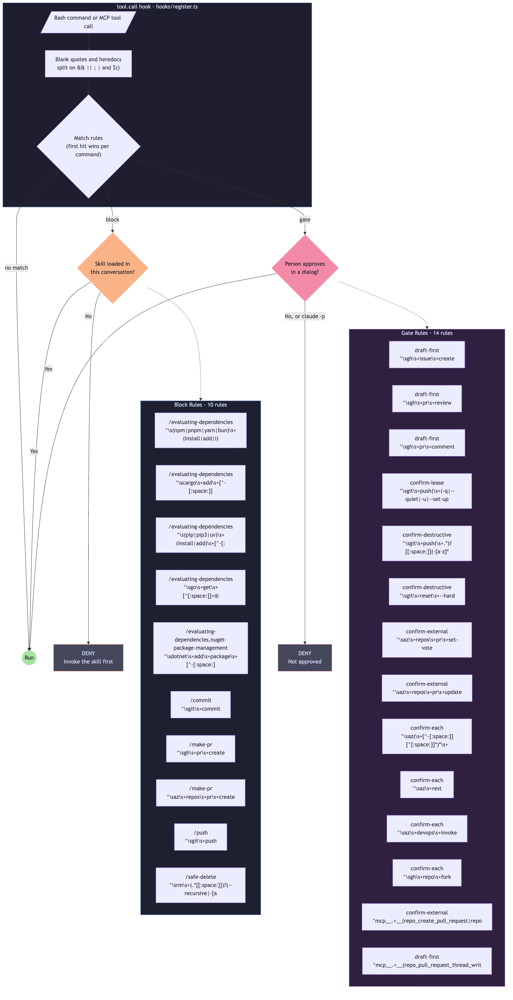

# skill-router

Makes Claude use the right skill for high-signal commands, and asks you before anything external or destructive runs.

It has two parts:

- **At session start** a settings hook injects the [skill-router meta-skill](../../skills/skill-router/SKILL.md), the map of which skill fits which task.
- **On every tool call** a mod (`hooks/register.ts`) checks the call against [`scripts/advisor-rules.conf`](scripts/advisor-rules.conf).



The diagram is generated from the rules file; its source is [`diagrams/hook-flow.mmd`](diagrams/hook-flow.mmd).

## What the rules do

- **block:** the command is refused until the named skill has loaded in this conversation, through the Skill tool or `/name`. `git commit` needs `commit`, `gh pr create` needs `make-pr`, `npm install <pkg>` needs `evaluating-dependencies`, `rm -r` needs `safe-delete`, and so on. A subagent has to load the skill itself, and a compaction or `/clear` means loading it again.
- **gate:** the full command is printed in the transcript (with the text of any `--body-file`), then a dialog asks **Run it**, **Always allow in this project** or **Don't run**. Text you type under "Other" goes back to Claude as your instruction. "Always allow" covers that one rule for the repo the command runs in, keyed by its git remote (ssh and https clones and worktrees share it); an Azure DevOps MCP call is keyed by the project and repository it names instead. It isn't offered for force pushes, `git reset --hard` or forks; for a call that runs anything besides the gated commands (a `cd`, however it is spelled); for a command that names another repo (`-R`, `--repo`, `--org`, `--project`, `--repository`, a URL, `GH_REPO=` and similar); in a repo with more than one remote or a `gh repo set-default`, where gh might not post to that remote; or for an MCP call that bypasses branch policy. `/gates` lists what is allowed and `/gates reset` undoes all of it. This covers creating issues, PR reviews and comments, force pushes, `git reset --hard`, forks, and PR writes or comments through the Azure DevOps MCP server. With nobody to answer (`claude -p`), the command is refused. The dialog also works over Remote Control.

Each simple command in a Bash call is matched on its own: the call is split on `&&`, `||`, `;`, `|` and newlines, quoted text and heredoc bodies are ignored, and the body of a `$(...)` is matched as its own command. So a commit message that mentions `git push` is not a push, and `cd app && git push` still is.

## Editing the rules

Rules are tab-separated lines in `scripts/advisor-rules.conf`; the header in that file describes the format. The first matching rule wins for each command, so put specific rules before general ones. Patterns use `grep -E` syntax.

After an edit:

```bash
node plugins/skill-router/scripts/test-rules.ts        # rule cases against the real file
claude plugin test plugins/skill-router                # the mod's own tests
bash plugins/skill-router/scripts/generate-diagrams.sh --render
```

## Requirements

Claude Code 2.1.287 or later, since the checks run as a mod. On older versions only the session-start map loads.
